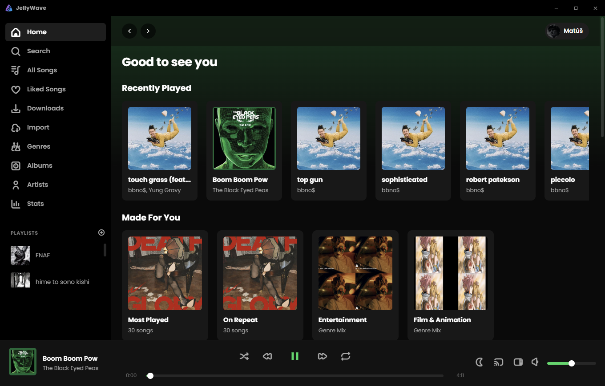
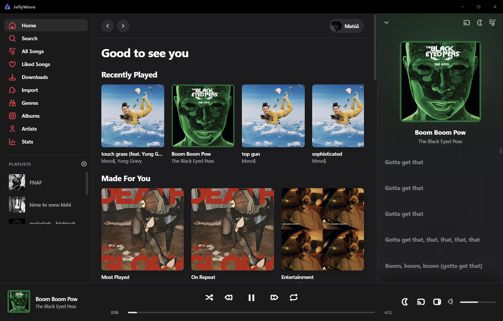
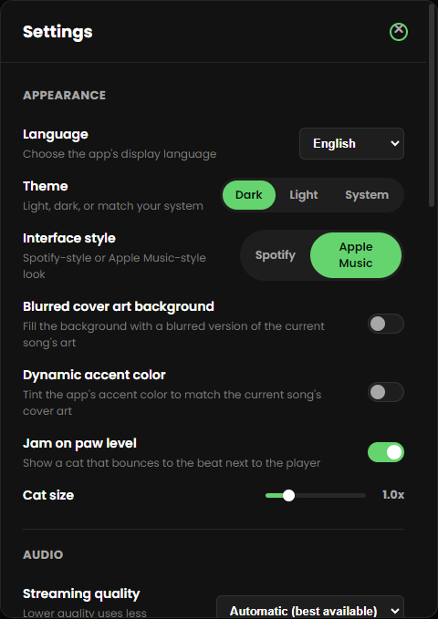
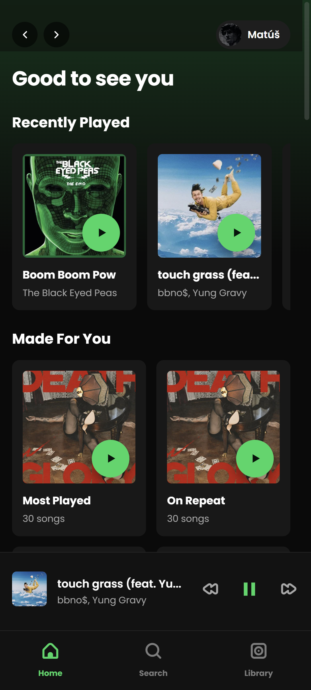
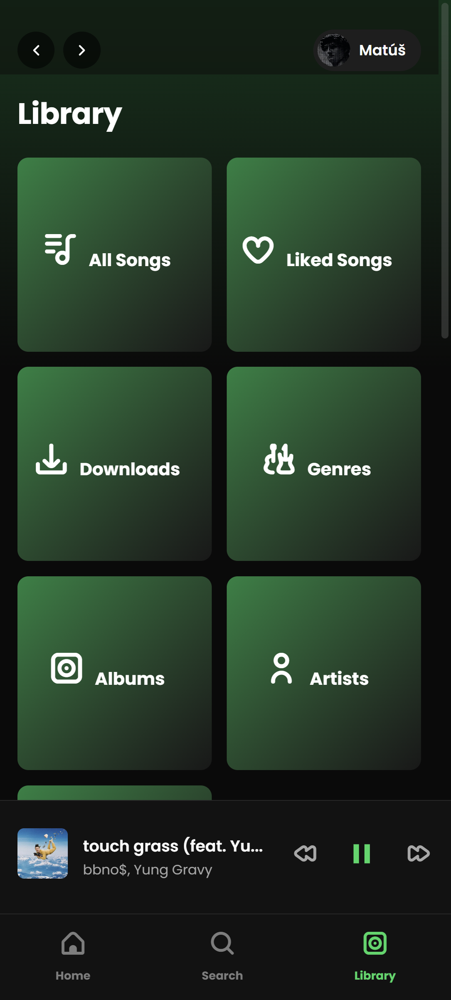
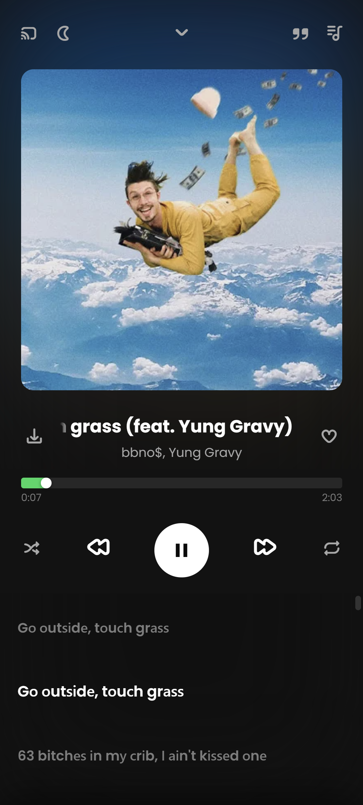
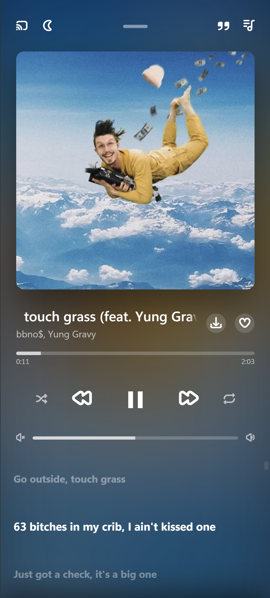

<p align="center">
  
</p>

<h1 align="center">JellyWave</h1>
<p align="center">A sleek, Spotify-styled music client for your own Jellyfin server.</p>

<p align="center">
  <a href="https://github.com/Greenythebeany/jellywave/releases">
    
  </a>
</p>

---

JellyWave is a personal music client for a self-hosted Jellyfin server. It logs into your own server with your own library and gives you a modern, Spotify-like listening experience across desktop and Android, without any of the server-side bloat of a general-purpose media app.

## Screenshots

<p align="center">
  
</p>
<p align="center">
  
</p>
<p align="center">
  
</p>

<p align="center">
  
  
  
  
</p>

## Features

- Full library browsing: Home, Search, All Songs, Liked Songs, Genres, Albums, Artists, and Playlists
- Gapless playback with optional crossfade (0-12 seconds) between tracks
- ReplayGain-based volume normalization, using loudness data from your server
- Lyrics for the currently playing track, from lrclib.net, your own Jellyfin server, or lyrics.ovh
- Queue view with shuffle and repeat modes
- Native lock-screen and notification media controls on Android, including playback that survives the app going to the background
- Discord Rich Presence on desktop: shows what you're currently listening to, with cover art
- Custom CSS support for further tweaking the look of the app, including a set of ready-made community color schemes (see [Themes](#themes) below)
- Two interface styles (Spotify or Apple Music), light and dark themes, a choice of accent colors, plus a blurred cover-art background option
- "Jam on paw level": an optional cat that bounces along with the actual bass of whatever's playing
- 15 language translations (English, French, German, Slovak, Czech, Spanish, Polish, Russian, Ukrainian, Norwegian, Swedish, Finnish, Danish, Dutch, Italian) with more welcome via contribution
- Desktop app built with Electron, Android app built with Capacitor, with one-click in-app updates on desktop

## Installation

Grab the latest build from the [Releases](https://github.com/greenythebeany/jellywave/releases/latest) page:

- **Windows**: download and run the installer (`.exe`)
- **Android**: download the `.apk` and install it (you will need to allow installs from your browser or file manager the first time)

On first launch, enter the address of your own Jellyfin server and sign in with your Jellyfin account.

## Themes

JellyWave ships a handful of built-in accent palettes, but you can also drop in a full community color scheme through **Settings → Advanced → Custom CSS** — paste one line in and it takes effect immediately, no restart needed:

| Preview | Theme | `@import` line |
| --- | --- | --- |
|  | Catppuccin Mocha | `@import url('https://cdn.jsdelivr.net/gh/greenythebeany/jellywave@main/src/themes/catppuccin-mocha.css');` |
|  | Catppuccin Macchiato | `@import url('https://cdn.jsdelivr.net/gh/greenythebeany/jellywave@main/src/themes/catppuccin-macchiato.css');` |
|  | Catppuccin Frappé | `@import url('https://cdn.jsdelivr.net/gh/greenythebeany/jellywave@main/src/themes/catppuccin-frappe.css');` |
|  | Catppuccin Latte | `@import url('https://cdn.jsdelivr.net/gh/greenythebeany/jellywave@main/src/themes/catppuccin-latte.css');` |
|  | Dracula | `@import url('https://cdn.jsdelivr.net/gh/greenythebeany/jellywave@main/src/themes/dracula.css');` |
|  | Nord | `@import url('https://cdn.jsdelivr.net/gh/greenythebeany/jellywave@main/src/themes/nord.css');` |
|  | Gruvbox Dark | `@import url('https://cdn.jsdelivr.net/gh/greenythebeany/jellywave@main/src/themes/gruvbox-dark.css');` |
|  | Gruvbox Light | `@import url('https://cdn.jsdelivr.net/gh/greenythebeany/jellywave@main/src/themes/gruvbox-light.css');` |
|  | Tokyo Night | `@import url('https://cdn.jsdelivr.net/gh/greenythebeany/jellywave@main/src/themes/tokyonight.css');` |
|  | Rosé Pine | `@import url('https://cdn.jsdelivr.net/gh/greenythebeany/jellywave@main/src/themes/rose-pine.css');` |
|  | Rosé Pine Moon | `@import url('https://cdn.jsdelivr.net/gh/greenythebeany/jellywave@main/src/themes/rose-pine-moon.css');` |
|  | Rosé Pine Dawn | `@import url('https://cdn.jsdelivr.net/gh/greenythebeany/jellywave@main/src/themes/rose-pine-dawn.css');` |
|  | Kanagawa | `@import url('https://cdn.jsdelivr.net/gh/greenythebeany/jellywave@main/src/themes/kanagawa.css');` |
|  | Solarized Dark | `@import url('https://cdn.jsdelivr.net/gh/greenythebeany/jellywave@main/src/themes/solarized-dark.css');` |
|  | Solarized Light | `@import url('https://cdn.jsdelivr.net/gh/greenythebeany/jellywave@main/src/themes/solarized-light.css');` |
|  | system24-inspired | `@import url('https://cdn.jsdelivr.net/gh/greenythebeany/jellywave@main/src/themes/system24.css');` |

The theme source files live in [`src/themes/`](src/themes/) if you want to tweak one or build your own.

### Making your own theme

Start from [`src/themes/template.css`](src/themes/template.css) — it lists every CSS custom property the app's colors are built from, with a short comment on what each one controls. Fill in your colors, paste the whole thing into Settings → Advanced → Custom CSS to preview it live, and once you're happy, save it as `src/themes/your-theme-name.css` and open a PR to get it listed in the table above.

## Discord Rich Presence

On desktop, JellyWave shows your currently playing track on your Discord profile, with cover art. It connects to your local Discord client automatically — the one extra step is authorizing the app once via **Settings → Audio → Discord Rich Presence → Connect** (or open [this link](https://discord.com/oauth2/authorize?client_id=1534197353056174180) directly).

Cover art is looked up externally by artist/album rather than pulled from your Jellyfin server, since Discord requires images to be served over HTTPS and most self-hosted Jellyfin setups are plain HTTP/LAN-only.

## Building from source

```bash
npm install
npm start          # run the desktop app
npm run dist        # build a Windows installer
```

The Android project lives in `android/` and is a standard Capacitor project — open it in Android Studio, or build from the command line with `./gradlew assembleRelease` after setting up your own signing keystore in `android/keystore/keystore.properties`.

## What's new in 2.0.4

- A Spotify-style queue: songs you add play in the order you added them, before the rest of the album or playlist, shown separately under "Next in queue" (with a Clear button). They survive starting a new album, shuffling and jumping ahead. While you drag a song to reorder, the other upcoming songs dim
- Automatic streaming quality now actually adapts: it measures your connection and picks original quality or 320/192/96 kbps, re-checking every few minutes and when the network changes (Settings shows what it's using)
- Faster on slow connections: cover images are requested at the size they're shown on your screen, and the next song only preloads once the current one is fully downloaded
- Phones: the "Automatic update check" switch now shows and is respected; Settings no longer shows empty section headings
- Settings layout fixes (long dropdown options, the About credits)

## What's new in 2.0.3

- Pick up where you left off: the queue, song and position are restored (paused) the next time you open JellyWave
- A smarter Home: Jump Back In, "Because you listened to…" and Newly Added rows
- Wrapped: on December 31 your year in music arrives as a tap-through story (minutes listened, a drumroll for your top artist over their own background and logo, top songs, biggest month), and stays on Home/Stats until January 7
- Real listening time: stats count the seconds you actually listen, summed across your devices, instead of plays × track length
- Settings → Storage: see and clear downloaded songs; haptic feedback can be turned off on phones
- Fixed the phone's lyrics sheet sometimes showing an old queue above the lyrics, and icons sitting slightly high in their buttons

## What's new in 2.0.2

- Accent colors are back, for both interface styles: Default (Spotify green / Apple red), Blue, Green, Red, Magenta, Purple, Pink, Orange, Yellow, Teal, Brown and Monochrome
- More lyrics sources: if lrclib.net doesn't have a song, JellyWave now also checks your own Jellyfin server's lyrics (`.lrc` files / embedded lyrics) and then lyrics.ovh
- Phone volume: the slider now follows the volume buttons instantly on Android, and controls and follows the iPhone's volume on iOS
- iPhone: logging in with a server IP address (e.g. a Tailscale `100.x` address) now works, not just a hostname
- Library is now a clean list (icon, name, chevron) in both styles, and genre tiles lose their gradient
- Apple Music style: shuffle and repeat clearly show when they're on
- Tap the top of the phone's full-screen player to close it
- Fixed the language dropdown showing white-on-white, a hidden switch knob with Monochrome, and the like heart sitting slightly high

## What's new in 2.0.1

- Artist pages: the banner now runs up behind the top bar in the Apple Music style too, and the back/forward and profile buttons get a dark backing over the photo so they stay readable
- Apple Music style: smoother volume and seek sliders (the fill now tracks your finger exactly), and song lists without the alternating row stripes
- Centered the like icon in the full-screen player
- The "What's new" popup now also shows when updating straight from 1.0.x to a later 2.x version
- Updated screenshots

## What's new in 2.0.0

A big one. Highlights:

**New look**
- Interface style setting (Settings → Appearance): the existing Spotify look, or a new Apple Music look with frosted glass, bare rounded artwork, slim pill sliders, a floating mini-player and a full-screen player built around the blurred cover
- Each style has its own default accent (Spotify green / Apple red); the community [Themes](#themes) recolor either style
- Open animations for popups, menus, pages and the player, and a loading screen on start instead of the login form flashing up

**Player**
- Instant skipping: the next song buffers in the background, so Next (and going straight back) starts immediately
- The queue slides up as a sheet from the bottom of the player on desktop and phones; the desktop side panel always shows lyrics, and phones get a full-size lyrics sheet
- Phone gestures: swipe the cover for next/previous, swipe down to close the player, pull down any page to refresh it
- Long song titles scroll instead of being cut off, and the mini-player has previous/next buttons
- Android: the volume slider controls the phone's media volume and follows the volume buttons
- Desktop keyboard shortcuts: Space to play/pause, Ctrl + ← / → for previous/next

**Updates and reliability**
- One-click updates on desktop: new versions download, get verified and install from inside the app, which closes itself cleanly for the installer
- Starting offline goes straight to Downloads instead of an empty Home
- Lyrics retry when the lyrics service is flaky, are remembered for the session, and show a Retry button instead of a false "No lyrics found"
- A "What's new" popup on the first launch after an update
- Fixed the track menu opening while scrolling, queue drag-to-reorder dropping songs in the wrong place, the off-center download spinner, Android's blue tap highlight, and more

## What's new in 1.0.2

- Personal stats (Most Played, On Repeat, Recently Played, the stats page) now sync via your Jellyfin account instead of living in one device's local storage
- A play only counts once a track actually finishes, not just when it starts
- Top Artists now counts each artist on a collab track individually instead of treating "A, B, feat. C" as one distinct artist per lineup
- Connect now properly hands off playback — the sending device stops local audio, and play/pause/skip/seek/volume (desktop, mobile, hardware media keys) all control the connected device until you disconnect or pick something new to play locally
- Connect's device list is now scoped to other JellyWave instances only, and has a mobile entry point (it previously lived in a desktop-only part of the player bar)
- Fixed Connect's now-playing display going stale (an HTTP caching issue on repeated session polls)
- Fixed the app reporting itself as "Desktop" to Jellyfin on every platform, and a stale client version number
- Fixed the installer sometimes being unable to close a running instance during an update
- Recently Played is now a single horizontally-scrolling row instead of a grid that could grow several rows tall
- Fixed a couple of broken icon references (the Connect button, the queue drag handle)

## What's new in 1.0.1

- Fixed session getting logged out on transient network/server errors instead of only on an actual expired token
- Sleep timer (stop playback after N minutes, or at the end of the current track)
- Recently played history view, separate from "recently added"
- Keyboard media key support on desktop (play/pause/skip from your keyboard, not just in-app)
- Smart playlists (auto-generated "most played," "on repeat," genre mixes)
- Swipe gestures on Android track lists (swipe to queue / remove)
- Queue drag-to-reorder (drag a queue item to a new position by its handle)
- Dynamic UI accent color pulled from the currently playing album art, Spotify-style (opt-in in Settings)
- Personal listening stats page (top artists/tracks, total listening time), built from local play history
- Built-in 5-band equalizer (desktop)
- Right-click context menu on desktop for tracks and queue items
- Drag-and-drop a track onto a playlist in the sidebar or a playlist card, on desktop
- Spotify Connect-style device handoff, built on Jellyfin's own `/Sessions` API — hand off playback to another device, or let another Jellyfin client cast to JellyWave

## Acknowledgements

- [Jellyfin](https://jellyfin.org/) for the media server this app talks to
- [Uicons by Flaticon](https://www.flaticon.com/uicons) for the icon set
- [BlafKing's spicetify-cat-jam-synced](https://github.com/BlafKing/spicetify-cat-jam-synced) for the "Jam on paw level" cat animation

## Legal & Privacy

JellyWave is free, open-source, and doesn't run any backend of its own — see [`docs/legal/`](docs/legal/) for the full [Privacy Policy](docs/legal/PRIVACY.md), [Terms of Service](docs/legal/TERMS.md), [Refund Policy](docs/legal/REFUNDS.md), [Cookie & Local Storage Policy](docs/legal/COOKIES.md), [Data Deletion](docs/legal/DATA_DELETION.md), [Third-Party Notices & Licenses](docs/legal/THIRD_PARTY_NOTICES.md), and [Accessibility Statement](docs/legal/ACCESSIBILITY.md). These are also viewable inside the app under **Settings → About → Legal**.

## License

MIT
